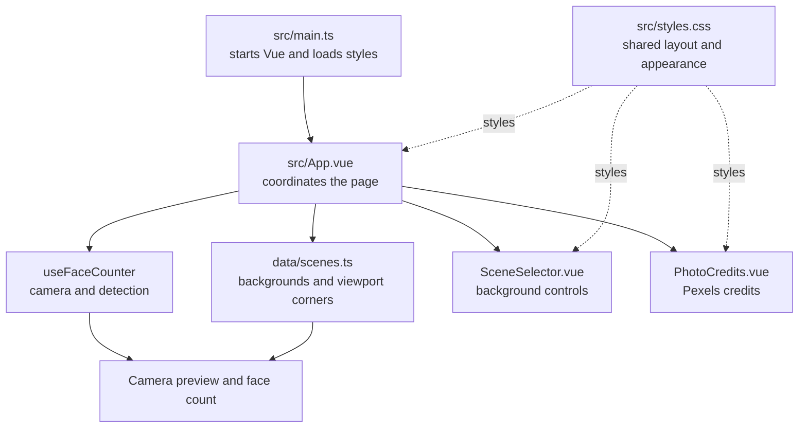
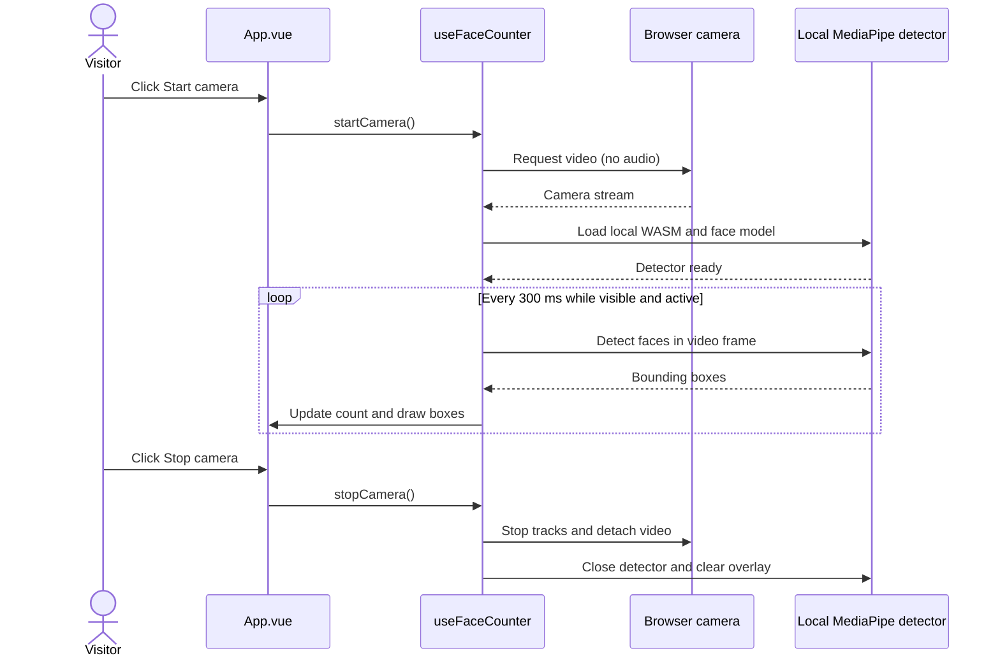
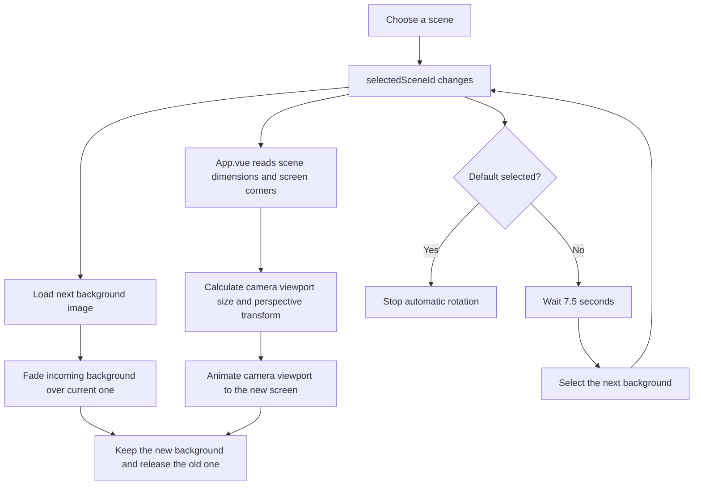

# Careers Fayre Face Counter

A small Vite + Vue 3 browser demo that counts visible faces. The opening screen is a complete camera-off fallback, so the stand can still use the app if the live demo is not ready.

## How the app is organised

`src/main.ts` starts Vue and loads the shared stylesheet. `src/App.vue` is the page coordinator: it connects the camera state, selected background, counter display, and page layout.

- `src/composables/useFaceCounter.ts` manages camera permission, the local MediaPipe detector, face counting, drawing detection boxes, and stopping the camera cleanly.
- `src/data/scenes.ts` lists each background, its image dimensions, the screen viewport corner positions, and its Pexels photo credits.
- `src/components/SceneSelector.vue` displays the background choices and tells `App.vue` which one was selected.
- `src/components/PhotoCredits.vue` displays the expandable Pexels photo credits table.
- `src/styles.css` contains the shared visual styles and responsive layout rules.

The camera preview is positioned over each background using the viewport corner coordinates in `scenes.ts`. The detector analyses the camera video itself; the displayed preview can be cropped to fit a background without limiting which detected faces contribute to the count.

### How the pieces fit together



### Camera start, detection, and stop



The count uses every detection returned for the video frame. The canvas draws the boxes over the visible viewport.

### Background rotation and screen placement



`Default` is a still scene for explaining the demo. Other backgrounds rotate every 7.5 seconds. Each background's viewport corners are percentages in `src/data/scenes.ts`, so those values determine where and how the camera preview is projected.

## Requirements

- Node.js 20 or newer and npm.
- A current browser with camera support (use the intended MacBook and browser for the event check).
- Camera permission and a consenting participant-facing camera position.

## Setup and build

```sh
npm install
npm run build
```

The build preparation step copies the MediaPipe WASM runtime from `node_modules` and downloads the BlazeFace full-range model into `public/vision/`. This initial preparation needs internet access. The generated assets are ignored by Git; repeat `npm run build` after a fresh checkout. The app pins MediaPipe Tasks Vision 1.0.1. Once prepared and built, the app's runtime loads its JavaScript, WASM, and model from the same origin.

## Run locally (including offline at the event)

Serve the built app over localhost. Camera access usually requires a secure browser context; do not open `index.html` as a file.

```sh
npm run preview -- --host 127.0.0.1
```

Open the localhost URL printed by Vite Preview (normally `http://127.0.0.1:4173/`). Keep the computer awake and leave the preview server running. For development use `npm run dev`; the detector assets must already have been prepared at least once.

To check offline launch, complete setup and build first, turn Wi-Fi off, then start the preview server and open localhost. This README does not claim that offline operation or the actual event MacBook has been verified; record that check in the go/no-go checklist below.

## Camera permission troubleshooting

- Click **Start camera** and allow access when the browser asks.
- If permission was denied, open the browser's site settings for localhost, set Camera to Allow, reload, then try again.
- Close other apps or tabs using the camera if the browser reports that it is unavailable.
- Keep using the standby screen if access cannot be restored. The app never turns the camera on automatically.
- Click **Stop camera** to stop all tracks and clear the preview immediately.

## Privacy and operation

Detection runs in this browser on this Mac. Video frames are analysed in memory and discarded; nothing is recorded, uploaded, logged, or retained by this app. Do not aim the camera at anyone who has not consented. A face may not be counted when turned away, hidden, outside the frame, or missed by the detector. This notice describes app behaviour and is not a claim of GDPR compliance.

The app requests no microphone, has no backend, analytics, telemetry, database, identity matching, face enrolment, age or emotion estimates, or network API. At runtime, Vite Preview serves the JavaScript, MediaPipe WASM, and model from this computer.

## License notes

See [THIRD_PARTY_NOTICES.md](./THIRD_PARTY_NOTICES.md) for detector/runtime attribution and license details.
