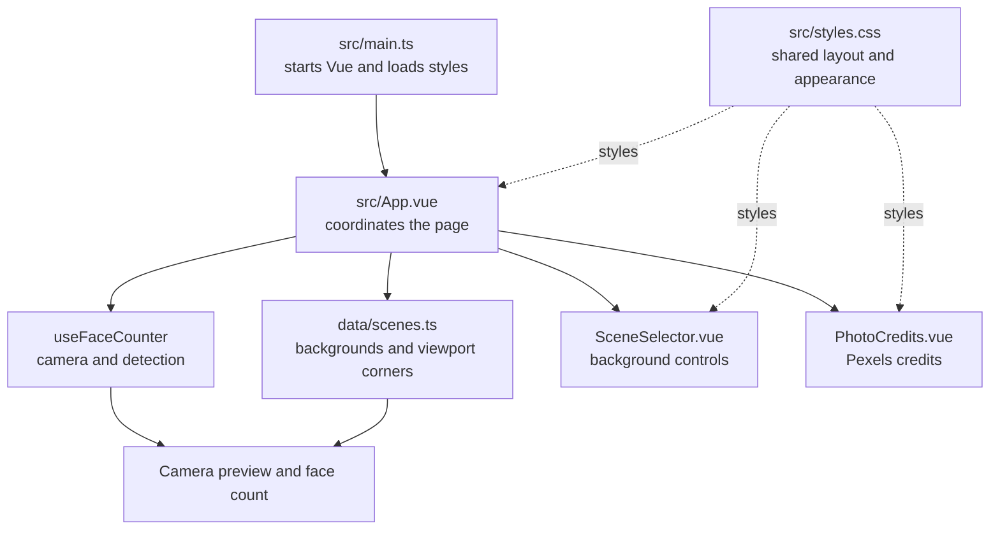
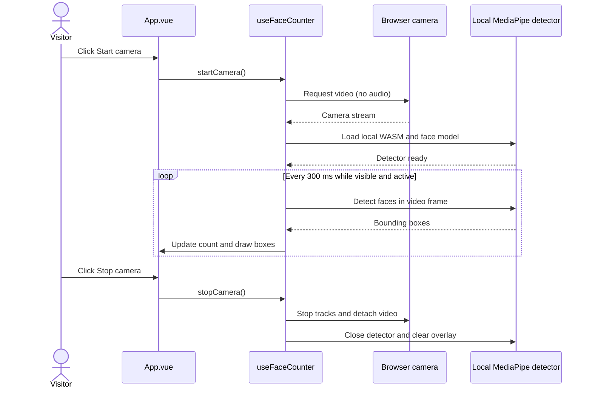
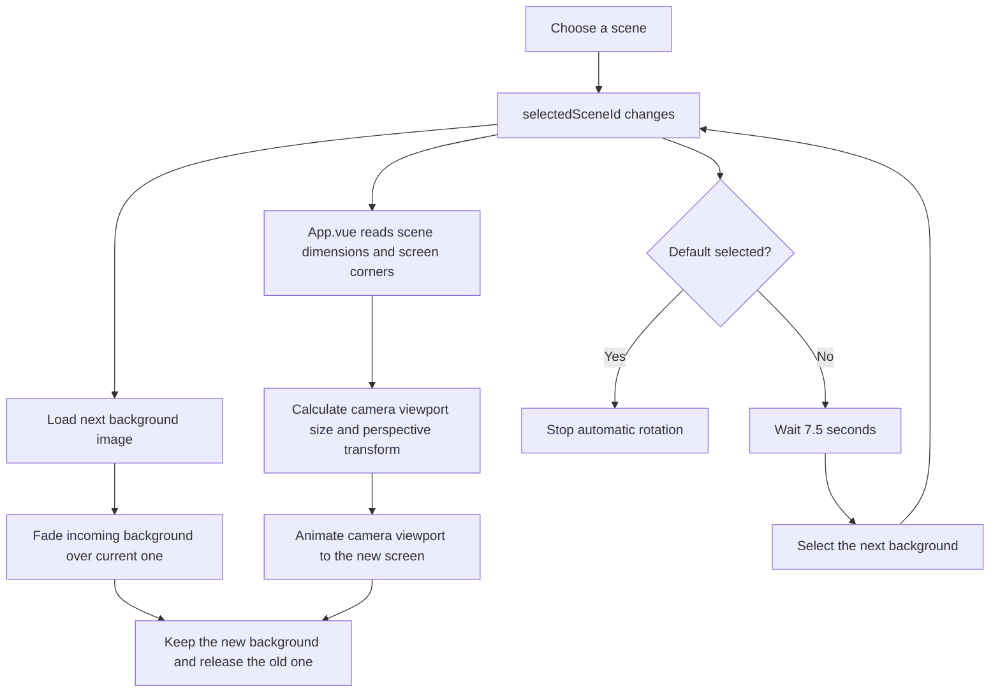
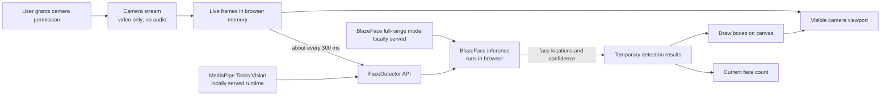

# Face Counter

A small Vite + Vue 3 browser demo that counts visible faces. The opening screen is a complete camera-off fallback, so the stand can still use the app if the live demo is not ready.

## Visitor interface

- Use **Start camera** to begin. The same button becomes **Stop camera**, including while permission or detector loading is pending. The camera never starts automatically.
- The off screen says **Camera off**, not that detection is ready. **Ready for the first face** appears only when detection is active and no faces are detected.
- Expand **Privacy and personal data** for camera processing, retention, consent and Google's separate SDK telemetry. The notice does not claim that all network traffic stays on-device.
- Expand **AI and the code behind this demo** for the AI explanation, development provenance, source code and process flowcharts.
- **Built with** is always visible to the left of the camera button, with locally served technology logos separated into this app's tooling and the wider company toolkit. On small screens the button moves below the logos.
- The Salto logo links to the [XS4 Face product page](https://saltosystems.com/en/products/face-recognition-terminals/xs4-face/). This counting demo does not implement that product's identity recognition.

## AI use and development provenance

The runtime AI is Google's pre-trained BlazeFace full-range face detector, accessed through MediaPipe Tasks Vision. It is a specialist machine-vision neural network, not a large language model (LLM). It locates faces; this app counts its detections and does not identify people.

Development of this program was agent-driven, with strong CI/CD rules and both human and AI review, as reported by the project maintainer. AI coding agents helped create and change the app. The proportion of AI-written code has not been measured; there is no verified percentage to quote. AI assistance does not replace human responsibility, testing or review, and this description is not a claim that any particular CI check has run.

For company discussion, face recognition is an example of machine vision using a specialist neural network rather than an LLM. Keep that separate from this demo's detection-only behaviour. The company toolkit supplied by the maintainer includes Docker, Node.js, JavaScript, Vue, Quasar, Python, Terraform, GitHub, Raspberry Pi, Ubuntu and C++; inclusion here does not mean all are dependencies of this app.

## How the app is organised

`src/main.ts` starts Vue and loads the shared stylesheet. `src/App.vue` is the page coordinator: it connects the camera state, selected background, counter display, and page layout.

- `src/composables/useFaceCounter.ts` manages camera permission, the local MediaPipe detector, face counting, drawing detection boxes, and stopping the camera cleanly.
- `src/data/scenes.ts` lists each background, its image dimensions, the screen viewport corner positions, and its Pexels photo credits.
- `src/components/SceneSelector.vue` displays the background choices and tells `App.vue` which one was selected.
- `src/components/PhotoCredits.vue` displays the expandable Pexels photo credits table.
- `src/components/AboutDemo.vue` contains expandable privacy, AI/provenance and source-code information.
- `src/components/BuiltWith.vue` displays the technology logos alongside the camera control.
- `src/styles.css` contains the shared visual styles and responsive layout rules.

The camera preview is positioned over each background using the viewport corner coordinates in `scenes.ts`. The detector analyses the camera video itself; the displayed preview can be cropped to fit a background without limiting which detected faces contribute to the count.

### How the pieces fit together



### Camera start, detection, and stop



The count uses every detection returned for the video frame. The canvas draws the boxes over the visible viewport.

### Background rotation and screen placement



`Default` is a still scene for explaining the demo. Other backgrounds rotate every 7.5 seconds. Each background's viewport corners are percentages in `src/data/scenes.ts`, so those values determine where and how the camera preview is projected.

## Security and data flow

The camera image and MediaPipe telemetry follow separate paths:

### Camera image: processed in the browser



The app processes camera frames in the browser. It does not upload the frames or face boxes to an application server or Google, identify people, or save the images or detections. The count is a live estimate of faces in each processed frame, not a count of unique visitors.

### Usage information: sent to Google


The SDK sends aggregate usage and performance metrics to Google. **This payload does not contain camera images, video frames, face boxes, or the face count displayed by the app.** The request itself does reveal ordinary connection metadata to Google, such as the source IP address and when the request arrived. The Docker setup serves the app and model from the same computer, but does not prevent this separate telemetry request.

See [Third-party notices](THIRD_PARTY_NOTICES.md) for detailed diagrams, component roles, telemetry behavior, and privacy implications.

## Requirements

- Node.js 20 or newer and npm.
- Docker Desktop or another Docker Engine with Docker Compose, if using the container workflow.
- A current browser with camera support (use the intended MacBook and browser for the event check).
- Camera permission and a consenting participant-facing camera position.

## Setup and build

```sh
npm install
npm run build
```

The build preparation step copies the MediaPipe WASM runtime from `node_modules` and downloads the BlazeFace full-range model into `public/vision/`. This initial preparation needs internet access. The generated assets are ignored by Git; repeat `npm run build` after a fresh checkout. The app pins MediaPipe Tasks Vision 1.0.1. Once prepared and built, the app's runtime loads its JavaScript, WASM, and model from the same origin.

## Run with Docker

Docker builds the app and detector assets into an image, then serves the static site locally. Start Docker Desktop first, then run:

```sh
docker compose up --build
```

Open <http://localhost:8080> and allow camera access when prompted. Press `Ctrl+C` to stop the server; run `docker compose down` to remove the stopped container. The first build needs internet access to install npm packages and fetch the face detector model. Once built, the container serves the app and detector assets locally. The browser uses the computer's camera; the container does not need direct camera-device access.

## Run an app image from Docker Hub

These steps are for each tester. They need Docker Desktop (or another running Docker Engine) and a browser on the same computer.

1. Open Docker Desktop and wait for it to finish starting.
2. Open a terminal and download the image.

   ```sh
   docker pull eddavey/careers-fayre-face-counter:latest
   ```

3. Start the app:

   ```sh
   docker run --rm -p 127.0.0.1:8080:80 eddavey/careers-fayre-face-counter:latest
   ```

4. In a browser on that same computer, open <http://localhost:8080> and allow camera access when prompted. The camera stays on that computer; the container only serves the app files.
5. When finished, return to the terminal and press `Ctrl+C` to stop the app.

Docker Hub distributes the image; it does not provide a normal website link to open. Testers must download the image before going offline. After the download, the app files and face detection can run locally without internet access. MediaPipe's separate telemetry requests cannot reach Google while the computer is offline. If port `8080` is already in use, replace `8080` in both the run command and the browser address with another available port, such as `8081`.

## Run locally (including offline at the event)

Serve the built app over localhost. Camera access usually requires a secure browser context; do not open `index.html` as a file.

```sh
npm run preview -- --host 127.0.0.1
```

Open the localhost URL printed by Vite Preview (normally `http://127.0.0.1:4173/`). Keep the computer awake and leave the preview server running. For development use `npm run dev`; the detector assets must already have been prepared at least once.

To check offline launch, complete setup and build first, turn Wi-Fi off, then start the preview server and open localhost. This README does not claim that offline operation or the actual event MacBook has been verified; record that check in the go/no-go checklist below.

## Camera permission troubleshooting

- Click **Start camera** and allow access when the browser asks.
- If permission was denied, open the browser's site settings for localhost, set Camera to Allow, reload, then try again.
- Close other apps or tabs using the camera if the browser reports that it is unavailable.
- Keep using the standby screen if access cannot be restored. The app never turns the camera on automatically.
- Click **Stop camera** to stop all tracks and clear the preview immediately.

## Privacy and operation

Detection runs in the browser on this computer. Camera frames and per-frame face detections are processed in memory; the app does not record or upload them to an application server or Google. MediaPipe separately sends aggregate usage and performance metrics to Google, as described in [Security and data flow](#security-and-data-flow). Tell people about the camera before using it, and do not aim it at anyone who has not consented. A face may not be counted when turned away, hidden, outside the frame, or missed by the detector. This notice describes app behaviour and is not a claim of GDPR compliance.

The app requests no microphone and has no first-party backend or database, identity matching, face enrolment, age estimates, or emotion estimates. The pinned MediaPipe SDK does send telemetry to Google; the app code has no telemetry opt-out. At runtime, Vite Preview serves the app JavaScript, MediaPipe WASM, and model from this computer, but that does not prevent the SDK's separate telemetry request.

## License notes

See [THIRD_PARTY_NOTICES.md](./THIRD_PARTY_NOTICES.md) for detector/runtime attribution and license details.
