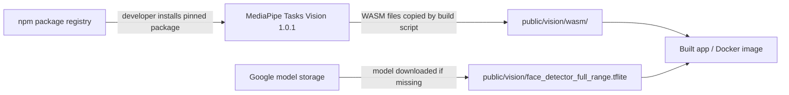
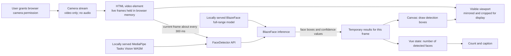
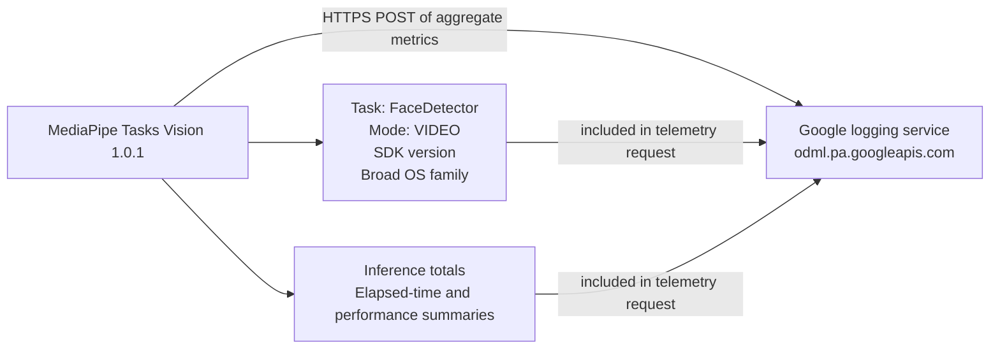

# Third-party notices and camera data flow

This file identifies the third-party components used for face detection and explains what happens to camera data. It describes the application code and bundled assets; it is not a substitute for the event organiser's privacy notice or legal review.

## MediaPipe Tasks Vision

- Package: [`@mediapipe/tasks-vision`](https://www.npmjs.com/package/@mediapipe/tasks-vision), version 1.0.1 (the version pinned in `package.json`).
- License: Apache License 2.0, as declared in the package metadata. The package's WASM runtime files are copied from the installed package into `public/vision/wasm/` during `npm run build`.
- Source: [MediaPipe](https://github.com/google-ai-edge/mediapipe).
- Role: MediaPipe Tasks Vision provides the browser API and WebAssembly runtime that loads the detector model, accepts video frames, and returns detections. It is the inference software; it is not the face-detection model itself.

## BlazeFace full-range face detector model

- Model: `blaze_face_full_range/float16/1`, from the [MediaPipe face detector model collection](https://developers.google.com/edge/mediapipe/solutions/vision/face_detector).
- License: Apache License 2.0, as stated in the [BlazeFace full-range model card](https://storage.googleapis.com/mediapipe-assets/MediaPipe%20BlazeFace%20Model%20Card%20(Full%20Range).pdf).
- Model file: `public/vision/face_detector_full_range.tflite`, downloaded from the published model URL by `scripts/prepare-vision-assets.mjs`.
- Role: BlazeFace is the trained detector. For each submitted frame it estimates whether faces are present and returns face bounding boxes and confidence values. It does not identify who a person is.

## Data flows

The diagrams below separate the image-processing path from the SDK telemetry path. Build-time downloads are shown separately because they happen when preparing the app, not while counting faces.

### 1. Build-time software and model downloads

`npm run build` copies the MediaPipe WebAssembly files from the installed package and downloads the model if it is missing. Docker builds include these files. This preparation needs internet access. At runtime, the browser loads the WASM and model from the app's own origin.

### 2. Camera image and face-detection results

After camera permission, `getUserMedia` supplies a video-only stream. `useFaceCounter.ts` passes the current video frame to `FaceDetector.detectForVideo` about every 300 ms. MediaPipe Tasks Vision runs the BlazeFace model in the browser. The frame and detection results stay in browser memory in the app's processing path; application code does not upload them to an app server or Google. The app counts detections that have bounding boxes and draws those boxes over the mirrored/cropped viewport.

The app does not compare faces across frames, identify people, create face templates, or save frames or detections. The count is an approximate count of faces visible in each processed frame, not a record of unique visitors.

#### What these terms mean for camera privacy

| Term | What happens to the camera image and people in the frame |
| --- | --- |
| **Locally served MediaPipe Tasks Vision runtime** | The browser downloads the JavaScript/WASM runtime from the same origin as the app (for the Docker setup, the local app container). This is software delivery: it does not itself upload camera frames. The runtime executes in the browser on the device showing the app. The SDK separately sends usage/performance telemetry as described below. |
| **FaceDetector API** | This is the MediaPipe interface the app calls with the live video element. In this app it receives frames in the browser and returns detections. It does not perform a name lookup, identify a person, or send the frame to an app server. |
| **Locally served BlazeFace full-range model** | This is the model file loaded by the browser from the app's own origin. It contains detector parameters, not photographs of event attendees. The model file is sent to the browser; camera frames are not sent to the model host for inference. |
| **BlazeFace inference** | The model calculations run in the browser using the current frame held in memory. The result is a set of face locations and confidence values for that frame. The app uses the locations to update the count and draw boxes; it does not keep a face identity or match a person across frames. |
| **People visible in the camera preview** | Their live image is displayed in the app and processed locally for face detection. The app does not record or save frames. A person may still be identifiable from the live image, so local processing does not remove the need to explain the camera use and manage participation appropriately. |

“Locally served” describes how the runtime/model files reach the browser; it does not alone prove that every network request stays on the device. In this project the Docker instructions serve the app from the same computer, and the application code passes video frames only to the in-browser detector. The separate telemetry request to Google remains an external runtime request, but its payload contains usage/performance metrics rather than camera images or detection boxes. If the app is later hosted on an internet server, the user will fetch the app and model from that host, while camera frames still remain in the browser unless the application code is changed to upload them.

### 3. MediaPipe usage and performance telemetry

Inspection of the pinned `@mediapipe/tasks-vision@1.0.1` bundle shows that the SDK sends a protobuf to `https://odml.pa.googleapis.com/v1/log`. For this app, the payload identifies the task as `FaceDetector`, the mode as `VIDEO`, the SDK version, and a broad operating-system family (for example, macOS). It reports counts and elapsed-time/performance summaries for detector setup and inference calls. This lets Google estimate that the detector was used, how often it ran, and how it performed on a class of device.

The SDK code does **not** add camera images, video frames, face boxes, or the app's displayed face count to that telemetry payload. Timing values come from `performance.now()` and are elapsed durations, not the person's wall-clock time of day. The SDK starts a 60-second flush timer and also flushes when the detector closes. The telemetry request itself reaches Google's server; as with ordinary internet requests, Google can see connection metadata such as the source IP address and when the request arrived.

Google’s [MediaPipe Terms of Service](https://developers.google.com/edge/mediapipe/legal/tos) state that input images/video are processed on-device and are not sent to Google, and describe metrics collection. The implementation is visible in the [version-pinned 1.0.1 bundle](https://unpkg.com/@mediapipe/tasks-vision@1.0.1/vision_bundle.mjs); a [MediaPipe maintainer response](https://github.com/google-ai-edge/mediapipe/issues/6306) describes the web telemetry rollout.

**Privacy implication:** inference is on-device, but the current app is not strictly offline at runtime while the detector is active: MediaPipe sends aggregate usage/performance metrics to Google when its logger flushes. The app code does not include a telemetry opt-out setting. If the event requires no third-party runtime requests, this dependency/version needs to be replaced or its telemetry requests blocked and validated before use. Do not describe the current build as sending no data to third parties.

**Model scope:** the [BlazeFace full-range model card](https://storage.googleapis.com/mediapipe-assets/MediaPipe%20BlazeFace%20Model%20Card%20(Full%20Range).pdf) describes intended use and limitations, including crowd counting being outside its stated scope. Treat this event counter as an approximate demonstration, not an authoritative attendance count.

The library and model are used for face detection, not identity recognition. A live image can still show identifiable people; the event organiser should explain the camera use and assess the appropriate lawful basis and safeguards, particularly when children may attend.
